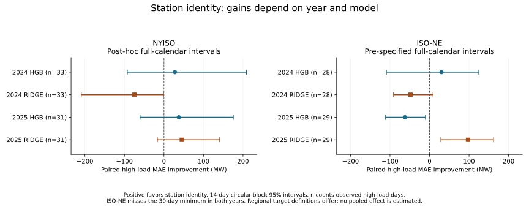

# Labelled weather station features in daily peak-demand hindcasts: evidence from New York and New England

Working research manuscript, version 1, 29 October 2026 (America/New_York).
Not peer reviewed. This manuscript synthesizes completed experiments; it adds
no new performance search. Authorship and affiliations are not asserted here.

## Abstract

Weather measurements from multiple locations can represent spatially uneven
electricity demand, but adding location-labelled features need not improve
prediction on high-demand days. We study their incremental value above calendar
and load history, aggregate weather, nonlinear distribution summaries, and
training-period load-exposure weights. Public NYISO and ISO-NE demand archives
are paired with NOAA temperature and dew point observations. Models train on
2019–2022, select parameters using 2023 all-day mean absolute error, and refit
through 2023. Histogram gradient boosting (HGB), ridge regression, and five
identity-scramble diagnostics are evaluated on 2024 and 2025. Under the GHCNh
weather version, HGB high-demand error falls by 5.31% and 6.35% in New York, but
both calendar-block intervals include zero. New England improves by 7.09% in
2024 and worsens by 9.10% in the fixed 2025 primary comparison; ridge has the
opposite annual directions. New England retains only 28 and 29 high-demand
days, below the specified 30-day minimum. A separate legacy-data New York
comparison changes sign after weather-version and baseline changes. The
evidence does not establish a stable high-demand benefit. The contribution is
an auditable empirical record of model, year, data-version, and comparator
sensitivity, rather than a new forecasting algorithm or a proof that spatial
information is ineffective.

## 1. Research question and prior work

The choice and combination of weather stations are established research
problems. Hong, Wang and White [1] study station selection for load forecasting.
Sobhani and colleagues [2] compare several station-combination methods against
simple averaging. Moreno-Carbonell and colleagues [3] investigate genetic-algorithm
selection, while Salmabadi and colleagues [4] use simulated annealing with
local search. These studies prevent treating multiple weather stations or
geographic coverage alone as new contributions.

The closest work found in this targeted review is Zhou and colleagues [5]. It
uses graph representations of geographically distributed meteorological
inputs and examines extreme scenarios in two Chinese cities. Its published
discussion also identifies the assumption of accurate future meteorological
inputs as a limitation. We have not reproduced that model. Our results neither
refute it nor establish superiority over it: target definitions, spatial
units, architectures and evaluation designs differ.

We ask a narrower empirical question: **do explicit station-labelled additions
improve high-demand hindcasts after aggregate and distributional weather
features already enter the baseline?** The baseline includes load-exposure
weights associated with geography. Thus this is not a comparison of all
geographic information against no geographic information. The added features
also contain no graph adjacency, spatial-distance operator, or independently
identified physical mechanism.

The literature search is targeted, not systematic. Several records were
available only as abstracts or selected publisher sections; the evidence read
for each is listed in [LITERATURE.md](LITERATURE.md). Absence of an identical
experiment from that search does not establish novelty.

## 2. Data and provenance

### 2.1 Regional targets

The New York target is the daily maximum of the simultaneous sum of hourly
integrated demand across eleven NYISO zones. Five airport proxies represent
coarse zone groups: BUF, SYR, ALB, LGA and ISP. Their mapping is an analyst
approximation, not an official service-area allocation.

The New England target sums eight SMD zonal `RT_Demand` observations within
each hour and then takes the daily maximum. It is a wholesale settlement
demand series, distinct from the workbook's `System_Load`. Seven unique
weather locations follow the SMD station mapping: PWM–ME, CON–NH, BTV–VT,
BDL–CT, PVD–RI/SEMA, ORH–WCMA and BOS–NEMA. Different target definitions and
numbers of stations limit direct cross-region comparisons of error magnitude.

All dates use America/New_York. ISO-NE's 2019–2023 files provide 24 normalized
rows on daylight-saving transition dates, whereas its 2024–2025 files retain
23/25 rows and mark an additional autumn hour as `02X`. A parser failure
exposed this before any ISO-NE model fitting. A committed amendment harmonized
the newer files to the earlier convention: interpolate spring HE02 from HE01
and HE03 and average autumn HE02 with HE02X. The four affected daily maxima
were numerically unchanged in these files. This does not establish equality
between normalized and physical-hour peaks in other datasets.

### 2.2 Weather and complete cases

GHCNh supplies temperature and dew point in degrees Celsius. Source-specific
quality rules, station identifiers and coordinates are checked. Source 999 is
excluded under a documented rule; other unreviewed finite-value sources stop
processing. A daily weather value requires at least 90% of its actual local
hours, including 23/25-hour days. Every model is scored on the same complete
case dates within a regional experiment. Exposure weights use only 2019–2022
zonal demand and remain fixed when models are refitted.

New York retains 365 test dates and 33 high-demand dates in the GHCNh 2024
bridge, and 338/31 in 2025. New England retains 356/28 in 2024 and 338/29 in
2025. Four known New England high-demand dates are missing from evaluation in
2025: June 5, June 19, July 3 and July 9. Missing weather at CON, BTV or ORH
causes their exclusion. Consequently, the score describes observed complete
cases, not every high-demand event. Missingness may be informative.

The original New York ISD analysis and its unsuccessful 2025 data-coverage
attempt remain preserved. Migration to GHCNh was a separate versioned
experiment. Historical archives can be revised; the experiments record hashes
and download times rather than assuming a point-in-time market dataset.

## 3. Models, estimand and evaluation

### 3.1 Nested representations and fixed search budgets

B0 includes calendar terms, lagged demand and a lagged seven-day mean. B1 adds
equal-weight and load-exposure-weight temperature/dew point summaries and
fixed heating/cooling hinges. B2 adds spread, quantiles, extremes, mean
site-level hinges and fractions above fixed temperature thresholds. B3 adds
labelled station anomalies and station-specific heating/cooling features.

HGB searches four combinations of leaf count (7/15) and L2 regularization
(1/10), with 200 iterations, learning rate 0.05, minimum leaf size 20 and
early stopping disabled. Standardized ridge searches alpha 0.1/1/10/100.
Each representation uses the same budget within its model family. Parameters
are selected by all-day 2023 MAE and models are refitted on 2019–2023. The
tail-focused endpoint therefore differs from the selection objective; we do
not claim the grid optimizes tail risk or matches best available forecasting
practice.

Five additional HGB pipelines use fixed within-day station permutations,
sharing the permutation between temperature and dew point. B2 is held fixed,
including its geographic exposure weights. These diagnose the additional
labelled channels; they are not causal randomization tests. The full search
contains thirteen pipelines and 65 fit calls. New England uses the same
procedure with local training data, not New York-trained coefficients.

### 3.2 Outcome and uncertainty

The high-demand threshold is each region's training-period 90th percentile:
24,966.5 MW for NYISO and 19,045.328 MW for ISO-NE. It is calculated before
weather exclusions. Define the paired difference on eligible high-demand
days as

\[
d_t=|y_t-\hat y_{B2,t}|-|y_t-\hat y_{B3,t}|.
\]

Positive mean difference favors B3. Relative improvement is
\(100[1-\mathrm{MAE}_{B3}/\mathrm{MAE}_{B2}]\). These quantities describe
realized same-day weather associations, not forecasts available before the
day begins. Historical load revisions also preclude an operational vintage
claim for the lagged inputs.

The interval procedure samples circular calendar blocks, retaining missing
and non-high-demand dates as NaN. The primary block length is 14 days, with
7/28-day sensitivity and 2,000 draws at a fixed seed. A draw with no finite
high-demand observation is omitted and its count is reported. The intervals
are conditional on fitted models and observed data. They do not refit the
training procedure, adjust for all research choices, or establish nominal
coverage under nonstationary, seasonally concentrated demand extremes.

The six-condition screen requires at least 30 high-demand dates, at least 5%
HGB relative tail improvement, a positive lower primary interval, positive
ridge tail improvement, superiority to at least four of five scrambles, and
all-day MAE no more than 2% worse. The 30-day threshold is a fixed screening
rule, not a power calculation. ISO-NE 2025 was fixed as primary and 2024 as
secondary before modelling. NYISO's 2024 GHCNh bridge followed observation of
both years and is explicitly post hoc. Passing individual conditions cannot
substitute for the whole predeclared screen.

## 4. Results

### 4.1 Descriptive comparison on GHCNh data

All errors and paired intervals below are in MW. NYISO intervals in this
summary use the supplementary full-calendar bridge; ISO-NE intervals were
specified to span the full calendar before fitting. The original NYISO 2025
primary HGB interval remains [−60.05, 163.19] MW and is not replaced by this
table's supplementary [−60.28, 175.62] MW interval.

<!-- EVIDENCE_TABLE_BEGIN -->

| Region | Year | Model | High days | B2 MAE | B3 MAE | Relative gain | Paired gain [95% interval] |
|---|---:|---|---:|---:|---:|---:|---|
| NYISO | 2024 | HGB | 33 | 525.39 | 497.49 | +5.31% | +27.90 [-92.57, +208.61] |
| NYISO | 2024 | RIDGE | 33 | 465.68 | 540.30 | -16.02% | -74.62 [-209.13, -0.84] |
| NYISO | 2025 | HGB | 31 | 592.53 | 554.89 | +6.35% | +37.64 [-60.28, +175.62] |
| NYISO | 2025 | RIDGE | 31 | 488.66 | 443.59 | +9.22% | +45.07 [-16.61, +140.21] |
| ISO-NE | 2024 | HGB | 28 | 426.65 | 396.40 | +7.09% | +30.24 [-108.88, +124.56] |
| ISO-NE | 2024 | RIDGE | 28 | 394.16 | 442.28 | -12.21% | -48.11 [-91.03, +8.86] |
| ISO-NE | 2025 | HGB | 29 | 680.80 | 742.77 | -9.10% | -61.97 [-111.73, -10.42] |
| ISO-NE | 2025 | RIDGE | 29 | 666.33 | 568.91 | +14.62% | +97.43 [+28.61, +161.85] |

<!-- EVIDENCE_TABLE_END -->

The table is generated from published files by `build_evidence.py`, which
checks paired-mean agreement and preserves the evidence roles in
[evidence.csv](evidence.csv). No pooled regional or two-year effect is fitted.

*Figure 1. Labelled-station additions compared with B2. Positive values favor
B3. NYISO full-calendar intervals are post hoc, and both ISO-NE years fall
below the high-demand sample minimum. Shared units do not make the regional
targets identical. The figure is descriptive and cannot be counted as eight
independent experiments.*

In the fixed New England 2025 comparison, HGB tail MAE increases from 680.80
to 742.77 MW despite an all-day improvement from 387.34 to 369.56 MW. The
14-day interval for paired improvement is entirely negative in the observed
29 high-demand cases. Ridge instead improves from 666.33 to 568.91 MW. HGB
beats zero of five identity scrambles. In 2024, HGB improves while ridge
worsens, and the HGB interval crosses zero. Thus changing the primary model
after observing 2025 would materially change the apparent conclusion.

Both ISO-NE screens fail, including their sample-size condition. The New York
2025 GHCNh screen also fails because its primary interval includes zero.
The New York 2024 bridge is descriptive, not a new successful confirmation.
Neither a negative HGB case nor a positive ridge case supports a universal
statement about geographic information.

### 4.2 Data-version and comparator sensitivity

The original New York 2024 ISD analysis yielded B2/B3 high-demand MAE of
464.72/511.51 MW, a relative deterioration of 10.07%. On the same 362 dates,
the later GHCNh comparison yields 525.39/497.49 MW, a 5.31% improvement. The
three extra GHCNh test dates are not high-demand dates, so the tail sign change
is not explained by simply adding those dates.

B3's tail error improves by about 14.02 MW, while B2's worsens by 60.67 MW.
This arithmetic explains the change in the paired comparison but is not a
causal decomposition: weather/QC values, six additional usable fitting days,
and selected B2 parameters differ. The baseline was selected using the
specified 2023 all-day objective; it was not intentionally weakened.
A separately labelled post-hoc check holding the older HGB B2 parameters
gives a 2024 gain of 3.77%, below the 5% screening threshold. These analyses
must not be presented as additional independent successes.

## 5. Interpretation, limitations and scope of contribution

The observed additional-station benefit changes with year and model. This is
a limitation of the tested representations and evaluation settings, not a
demonstration that weather geography lacks predictive information. B2 already
contains geographic load weights, B3 changes dimension, and the diagnostic
scrambles preserve B2. None of these experiments identifies the physical
mechanism responsible for a change in error.

Only two neighboring power regions and two evaluation years are examined.
Their weather and economic shocks can be correlated. Both years have now been
observed and cannot be reused as untouched confirmation data for a revised
method. Our station proxies, narrow grids and choice of all-day validation
loss restrict generalization. The 2025 New England missing events and small
tail samples further limit the inference. Wider intervals and unsuccessful
screening are scientifically relevant outcomes, not reasons to relax the
original criteria.

The defensible output is a reproducible empirical study documenting how the
incremental station-label comparison changes with data version, comparator,
model and year. It is not a new geographic forecasting theory. A further
methodological contribution would require a specific mechanism or design
hypothesis, credible contemporary baselines and new evaluation evidence.
For example, sensitivity to selecting parameters on overall rather than tail
error is a future hypothesis, not a result established here. A publication
claim also requires a fuller literature review and independent scientific
assessment.

## 6. Reproducibility and research record

Source commit `5e9ffef948d8a7f43b65f3929d077cc594b23a4f` contains the completed
regional experiment. A separate clean-snapshot check matched 154 geography
files to its Git blob hashes and passed all 58 offline tests. A reusable replay
copies 23 hash-pinned computational files into a temporary directory, blocks
Python socket connections, and repeats all 65 ISO-NE search/refit calls using
only the committed daily inputs. All 9,022 model predictions on 694 dates and
all selected parameters reproduce; the prediction CSV is byte-identical.
These 65 replay fits are operational verification, not 65 new scientific trials.

Independent arithmetic implementations also recheck published error metrics
and intervals. This is verification within the same research workflow, not a
third-party replication. Raw-archive reconstruction is a separate task and
can stop when upstream bytes change, especially at the 2026 boundary files.
Saving the frozen daily inputs supports replay without silently accepting
new archive versions.

The [reproduction report](REPRODUCIBILITY.md) provides commands, hashes and
limits. Original plans, amendments, failed coverage attempts, negative results
and all pipeline outputs remain available. AI assistance was used in code,
analysis and manuscript preparation; this draft has not received independent
scientific review.

## References

1. Hong, T., Wang, P., & White, L. (2015). Weather station selection for electric
   load forecasting. *International Journal of Forecasting*, 31(2), 286–295.
   [doi:10.1016/j.ijforecast.2014.07.001](https://doi.org/10.1016/j.ijforecast.2014.07.001).
2. Sobhani, M., Campbell, A., Sangamwar, S., Li, C., & Hong, T. (2019). Combining
   Weather Stations for Electric Load Forecasting. *Energies*, 12(8), 1510.
   [doi:10.3390/en12081510](https://doi.org/10.3390/en12081510).
3. Moreno-Carbonell, S., Sánchez-Úbeda, E. F., & Muñoz, A. (2020). Rethinking weather
   station selection for electric load forecasting using genetic algorithms.
   *International Journal of Forecasting*, 36(2), 695–712.
   [doi:10.1016/j.ijforecast.2019.08.008](https://doi.org/10.1016/j.ijforecast.2019.08.008).
4. Salmabadi, N., Salari, M., & Shadman, A. (2025). A weather station selection
   method based on the simulated annealing algorithm for electric load
   forecasting. *Neural Computing and Applications*, 37, 9275–9294.
   [doi:10.1007/s00521-025-10988-y](https://doi.org/10.1007/s00521-025-10988-y).
5. Zhou, Y., Lin, G., Sun, D., Liang, Z., & Zhang, N. (2025). Interpretable load
   forecasting via representation learning of geo-distributed meteorological
   factors. *International Journal of Electrical Power & Energy Systems*, 172,
   111283. [doi:10.1016/j.ijepes.2025.111283](https://doi.org/10.1016/j.ijepes.2025.111283).

Official data sources: [NYISO hourly integrated load](https://mis.nyiso.com/public/P-58Clist.htm),
[ISO-NE zonal SMD reports](https://www.iso-ne.com/isoexpress/web/reports/load-and-demand/-/tree/zone-info),
and [NOAA GHCNh](https://www.ncei.noaa.gov/products/global-historical-climatology-network-hourly).
Exact annual URLs and retrieval hashes are preserved with each experiment.
